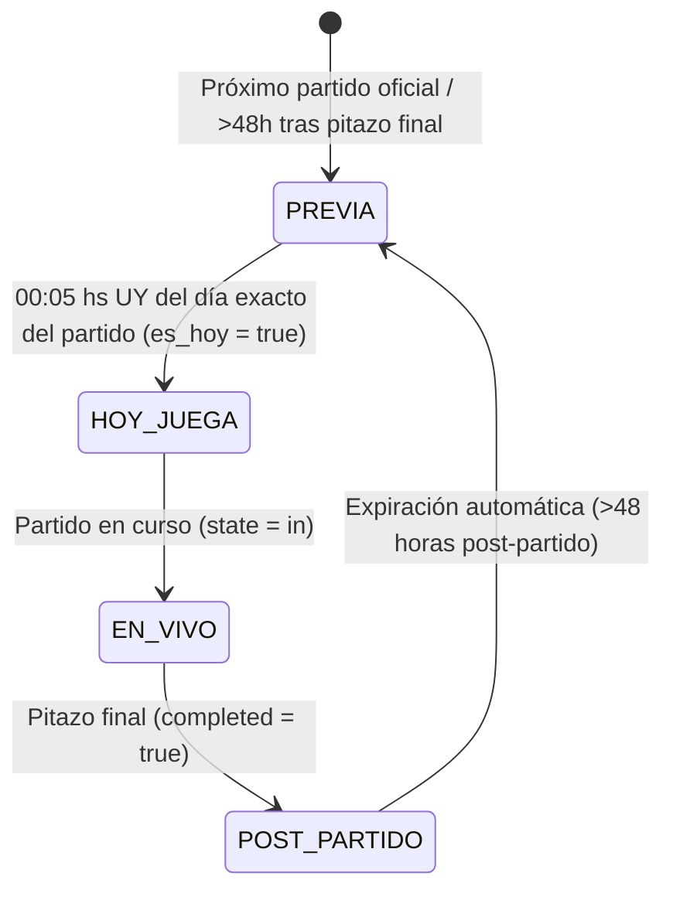

# Especificación Técnica y Arquitectura del Sistema (SPEC.md)
## Manya ServicioTI • Portal Integral y Match Center Oficial del Club Atlético Peñarol

**URL Pública:** [manya.servicioti.com.uy](https://manya.servicioti.com.uy/)  
**Ecosistema Blogger:** [www.servicioti.com.uy](https://www.servicioti.com.uy/)  
**Autor:** Andrés Franchi Ugartemendía (ServicioTI / eltopouy)  
**Versión:** 10.0 (Arquitectura Zero-Hardcode, Sync Hub Unificado Anti-Spam & UX Móvil/Desktop Renovada)  
**Última Actualización:** 20 de Noviembre de 2026  

---

## 1. Filosofía de Arquitectura v10.0 ("Zero-Hardcode")

La versión 10.0 elimina por completo cualquier rival, fecha, puntaje, goleador o jugador hardcodeado en el código fuente, logrando que el portal y su ecosistema de actualización se autoadapten a cualquier fecha del Torneo Apertura, Intermedio, Clausura, Definición del Campeonato Uruguayo o Copa CONMEBOL Libertadores sin intervención manual.

### Principios Rectores
1. **Única Fuente de Verdad Unificada (`sync_manya_hub.py`):** Tanto el daemon local de Windows, el watchdog de auto-curación, el cierre post-partido y el workflow de GitHub Actions ejecutan el mismo orquestador determinista.
2. **Reconciliación Automática de Datos Reales (ESPN + AUF + 1891 BD):**
   - `manya_match_engine.py` obtiene el calendario completo de Peñarol en **1 sola llamada** (`/teams/2683/schedule`), enriquece cada encuentro vía MCP oficial de la Comisión de Historia y Patrimonio (`https://mcp.1891.uy/mcp` — goleadores, juez, DT rival, once titular, cambios, observaciones y video oficial de YouTube), reconcilia automáticamente el rezago de la Tabla Anual AUF contra los partidos recién finalizados en ESPN, ordena matemáticamente la Copa Libertadores por `(pts, dg, gf)` y sincroniza el plantel real 2026 desde `/teams/2683/roster`.
   - Cuando finaliza la fase regular del Clausura, proyecta automáticamente el cuadro real de la **Definición del Campeonato Uruguayo** (Semifinal + Gran Final para el Campeón de la Tabla Anual) hasta que AUF/ESPN publiquen el `event_id` oficial.
3. **Anti-Spam de Git con Hash Semántico SHA-256:**
   - Antes de hacer commit o push, `sync_manya_hub.py` calcula un hash SHA-256 semántico de `data/` (ignorando campos volátiles como `actualizado` o `timestamp`), guardado en `data/.sync_state.json` (ignorado en `.gitignore`).
   - Los archivos efímeros (`logs/`, `*.db`, `data/health_status.json`, `data/.sync_state.json`) están excluidos de Git para erradicar los conflictos de merge y el spam de commits repetidos.
   - Todo push ejecuta previamente `git pull --rebase --autostash origin main`.
4. **SSR Seguro con BeautifulSoup:**
   - Las actualizaciones de snapshot estático en `index.html` se realizan exclusivamente por DOM/ID vía `BeautifulSoup` (cero reemplazos por regex frágiles que rompan etiquetas `
`).

---

## 2. Máquina de Estados del Match Center

- **Coherencia Estricta `partido_activo`:** En `POST_PARTIDO` y `EN_VIVO`, el Match Center, marcador, escudos, goleadores, línea de tiempo y scouting táctico reflejan siempre `partido_activo` (nunca se mezclan escudos del próximo partido con goles del anterior).
- **Horizonte Visible:** En `POST_PARTIDO`, el próximo compromiso o definición de playoff se muestra en su bloque diferenciado (`Próximo Compromiso` / `Cuadro de Definición del Campeonato Uruguayo`).

---

## 3. Ecosistema Híbrido de Actualización 24/7

### Nivel 1: Programador de Tareas de Windows (`registrar_tareas_programadas_resilientes.ps1`)
Todas las tareas utilizan `-StartWhenAvailable`, `-WakeToRun`, `-AllowStartIfOnBatteries`, `-MultipleInstances IgnoreNew` y rutas protegidas con `$env:USERPROFILE`:
1. **`Manya_Vigilante_Partidos_Y_Prensa` (cada 30 min, 06:15):** Ejecuta `manya_partidos_daemon.py --once` -> `sync_manya_hub.py --mode fast --commit`.
2. **`Manya_Guardian_Autocorreccion` (cada 60 min, 06:40 — escalonado):** Ejecuta `manya_self_healing_watchdog.py` (limpia locks huérfanos, ejecuta las 12 pruebas dinámicas y auto-repara si detecta fallas).
3. **`Manya_Madrugada_0005_Hoy_Juega` (diario 00:05 hs UY):** Ejecuta `manya_partidos_daemon.py --hoy-juega` para activar el modo Match Day únicamente si Peñarol juega hoy.

### Nivel 2: GitHub Actions Cloud Cron (`.github/workflows/actualizar_partidos.yml`)
- **Frecuencia:** Cada 2 horas (`22 */2 * * *`), escalonado respecto a Windows, con `concurrency: { group: manya-sync-main, cancel-in-progress: false }`.
- **Flujo:** `sync_manya_hub.py --mode ci` -> ejecuta las 3 suites de prueba (`test_tactical_board.py`, `test_editorial_coherence.py`, `test_manya_ecosystem.py`) -> commit y `git pull --rebase` + `git push` solo si existen cambios semánticos reales.

---

## 4. Calidad Editorial, Fotográfica y Prensa Deportiva

- **Prensa Deportiva (`manya_sports_press.py` v3.0):** Filtro estricto de relevancia Peñarol en los titulares de todos los feeds (Ovación, Referí, FútbolUy, Tenfield, Subrayado, Padre y Decano, Google News), lista negra contra ruido ajeno al fútbol, parseo de fechas a `UY_TZ` (UTC-3), descarte automático de notas con más de 10 días de antigüedad y ordenamiento cronológico descendente.
- **Fotografía y 1891 BD (`extraer_datos_1891.py` v3.0):** Descarga automáticamente fotografías reales de los partidos más recientes de la temporada vía `mcp.1891.uy` (`find_matches` + `get_match`), purga archivos obsoletos, sincroniza `data/galleries.json`, `data/instagram_feed.json` y `data/efemerides_hoy.json` en `UY_TZ`.
- **Plantel y Pizarra Táctica (`data/squad_2026.json` + `js/app.js`):** Plantel vivo 2026 (Aguerre, Pezzella, Nahuel Herrera, Olivera, Remedi, Darias, Cabrera, Leo Fernández, Leonel Jaime, Arezo, Abel Hernández, Batista, Laxalt, Lemos, Trindade, etc.), 3 formaciones (`4-2-3-1`, `4-3-3`, `4-4-2`), sustituciones e intercambios bidireccionales, etiquetas móviles legibles en 2 líneas y exportación PNG 1080×1350.

---

## 5. UX/UI Frontend v10.0 (`index.html`, `css/styles.css`, `js/app.js`, `sw.js`)

- **Cero Recortes en Desktop y Móvil:** Grillas principales protegidas con `minmax(0, ...)` y `min-width: 0; max-width: 100%` en `.dual-grid`, `.editorial-grid`, `.rival-scout-grid`, `.card-panel` y `.manya-table-wrap`.
- **Navegación Compacta:** Barra superior depurada a 8 accesos directos claros + botón flotante `↑` de retorno rápido.
- **Módulos Dinámicos:** Últimos 5 resultados (racha W/D/L), línea de tiempo del partido activo, scouting completo (fortalezas, vulnerabilidades, web oficial, figuras y 4 duelos 1x1), H2H 1891 BD con diferencia de goles calculada, Cuadro de Definición Uruguayo 2026 / Simulador de Tablas, Muro Fotográfico paginado con botón *"Ver más"*, galería de Tatuajes Carboneros con precisión histórica (11 estrellas y 9 franjas) y PWA `sw.js` v10.0 Network-First.

---

## 6. Suite de Pruebas Dinámicas (12 Invariantes — 100% Óptimo)

Ejecutadas automáticamente por `test_manya_ecosystem.py`, `test_editorial_coherence.py` y `test_tactical_board.py`:
1. Zona horaria oficial `UY_TZ` (UTC-3).
2. Coherencia temporal estricta `es_hoy` (cero falsos *"Hoy Juega"*).
3. Integridad matemática y ordenamiento de Tablas (Anual, Clausura y Copa Libertadores).
4. Sincronización cruzada entre `live_status.json`, `rival_intelligence.json`, `historial_activo.json` y 4 duelos 1x1.
5. Integridad estructural de los 11 datasets JSON en `data/`.
6. Salud de locks anti-colisión en `~/.manya_locks/`.
7. Accesibilidad HTTP 200 de los endpoints públicos de producción.
8. Armonía de versión PWA `v10.0` Network-First (`sw.js`, `index.html`, `app.js`) y protección anti-overflow en `css/styles.css`.
9. Existencia de escudos locales oficiales de todos los equipos de Copa CONMEBOL Libertadores.
10. Frescura fotográfica e integridad de galerías, influencers y tatuajes (cero archivos faltantes o fotos obsoletas).
11. Coherencia editorial, prensa deportiva fresca (`<= 14 días`) y SSR limpio de `index.html`.
12. Pizarra táctica interactiva con plantel real 2026 (sin ex-jugadores, sin dorsales repetidos, `node --check js/app.js` OK).
