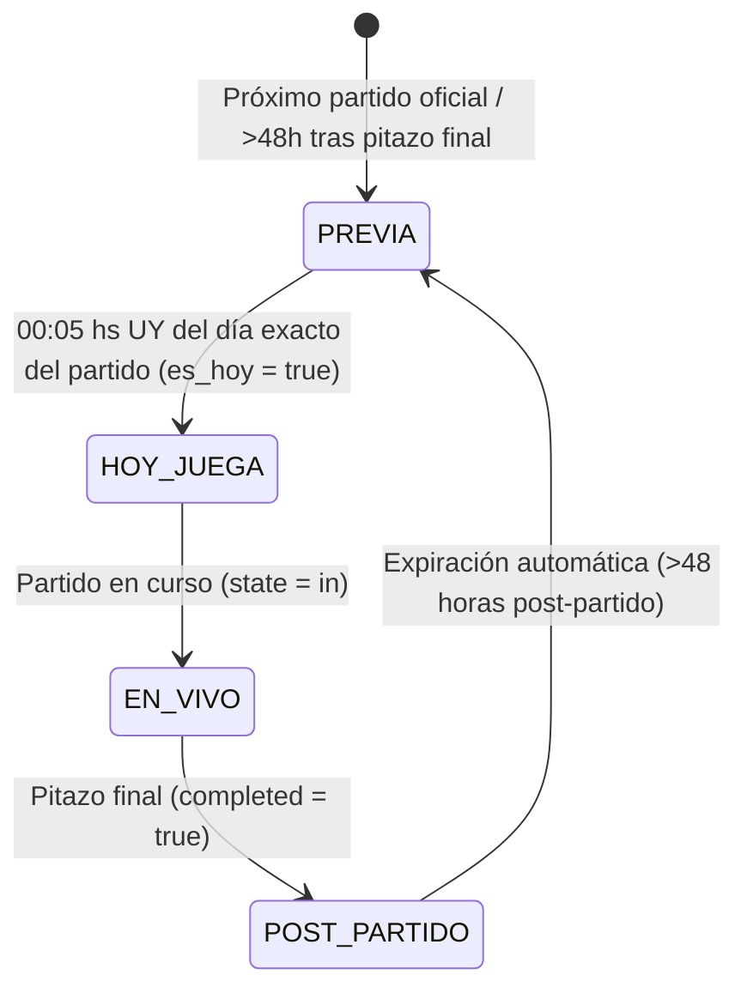

# Especificación Técnica y Arquitectura del Sistema (SPEC.md)
## Manya ServicioTI • Portal Integral y Match Center Oficial del Club Atlético Peñarol

**URL Pública:** [manya.servicioti.com.uy](https://manya.servicioti.com.uy/)  
**Ecosistema Blogger:** [www.servicioti.com.uy](https://www.servicioti.com.uy/)  
**Autor:** Andrés Franchi Ugartemendía (ServicioTI / eltopouy)  
**Versión:** 11.0 (Resiliencia HTTP/MCP, Plantel Verificado 1891 BD, Prensa Difusa, Seguridad XSS & UX/PWA Pro)  
**Última Actualización:** 20 de Noviembre de 2026  

---

## 1. Filosofía de Arquitectura v11.0 ("Zero-Hardcode & Resiliencia Total")

La versión 11.0 consolida la arquitectura Zero-Hardcode eliminando deuda técnica, duplicación de logs y scripts legacy obsoletos, al tiempo que añade resiliencia de red con caché local, precisión estadística 1891 BD en el plantel, prensa deportiva con deduplicación difusa y una experiencia Frontend/PWA de nivel profesional con blindaje XSS estricto.

### Principios Rectores
1. **Única Fuente de Verdad Unificada (`sync_manya_hub.py` v11.0):** Tanto el daemon local de Windows, el watchdog de auto-curación, el pipeline post-partido, los shims de compatibilidad (`actualizar_manya_completo.py`, `publicar_en_vivo_blogger.py`) y el workflow de GitHub Actions ejecutan el mismo orquestador determinista.
2. **Logging Limpio Sin Duplicación (`automation/manya_logging.py`):**
   - Todos los módulos activos utilizan `get_manya_logger()` con `logger.propagate = False` y handlers deduplicados.
   - Se erradicaron todos los `logging.basicConfig()` a nivel de módulo (`generar_cronica_gemini_narrativa.py`, `cerrar_partido_historico_blogger.py`, `sincronizar_pagina_proximo_partido.py`), garantizando que cada línea de log se emita exactamente 1 vez.
3. **Resiliencia HTTP/MCP y Caché de Respaldo (`manya_match_engine.py` v5.0):**
   - `_fetch_json`, `_fetch_text` y `call_1891_mcp` implementan reintentos automáticos con backoff exponencial + jitter ante fallas transitorias (5xx, 429, timeouts), sin reintentar 4xx permanentes.
   - Cada fuente externa (ESPN Schedule/Roster/Standings/Libertadores, AUF Tabla Anual, Open-Meteo y 1891 BD MCP) mantiene caché local de respaldo fuera del repositorio (`~/.manya_cache/`), preservando disponibilidad ante caídas temporales sin ensuciar Git.
4. **Reconciliación Automática y Auto-Transición Playoff/Finales 2026:**
   - Obtiene el calendario completo de Peñarol en **1 sola llamada** (`/teams/2683/schedule`), enriquece el encuentro activo con `mcp.1891.uy` (goleadores, juez, DT rival, alineación, cambios, observaciones y YouTube), reconcilia el lag de la Tabla Anual AUF contra ESPN y ordena la Copa Libertadores por `(pts, dg, gf)`.
   - Detecta automáticamente en ESPN la programación y resultado de la Semifinal (`Racing vs Ganador Clausura`) y sustituye de forma inmediata el horizonte sintético (`uf2026_final_ida`) apenas ESPN publique el `event_id` numérico oficial de la Gran Final del Uruguayo, sin intervención manual.
5. **Clima Campeón del Siglo + Pronóstico Horario de Partido (Open-Meteo `hourly`):**
   - Consulta condiciones actuales en `-34.7969, -56.0672` con catálogo WMO completo (incluyendo tormentas eléctricas, chaparrones y lloviznas) y pronóstico horario `hourly` para la hora exacta del próximo partido cuando falta `<= 7` días (`clima_campeon_del_siglo.pronostico_partido`).
6. **Anti-Spam de Git y SSR Seguro con BeautifulSoup:**
   - Hash semántico SHA-256 en `data/.sync_state.json` (ignorado en `.gitignore`), archivos efímeros (`logs/`, `*.db`, `data/health_status.json`) fuera de Git y `git pull --rebase --autostash origin main` antes de cada push.
   - `sync_index_ssr_snapshot()` actualiza únicamente nodos por ID vía `BeautifulSoup` (corregida en v11.0 la alineación de `#hero-last-result` con `js/app.js` para evitar texto duplicado, hidratación de `#hero-scorers-strip` y soporte `--no-ssr`).
7. **Saneamiento de Scripts Legacy (`automation/`):**
   - Modernizados a Zero-Hardcode v11.0 los módulos Blogger activos (`sincronizar_pagina_blogger_historico.py`, `blogger_manya_publisher.py`, `sincronizar_pagina_proximo_partido.py`, `cerrar_partido_historico_blogger.py`) y shims (`actualizar_manya_completo.py`, `publicar_en_vivo_blogger.py`).
   - Neutralizados/archivados con guardas seguras los 6 scripts puntuales de migración de octubre 2026 (`actualizar_frontend_cronica.py`, `actualizar_scripts_blogger.py`, `integrar_frontend_1891.py`, `publicar_previa_juventud.py`, `reestructurar_tripartita_frontend.py`, `sincronizar_oficialcap_centenario.py`) para impedir sobrescrituras accidentales con datos viejos.

---

## 2. Máquina de Estados del Match Center

- **Coherencia Estricta `partido_activo`:** En `POST_PARTIDO` y `EN_VIVO`, el Match Center, marcador, escudos, goleadores, línea de tiempo en español limpio y scouting táctico reflejan siempre `partido_activo`.
- **Horizonte Visible:** En `POST_PARTIDO`, el próximo compromiso o cuadro de definición de playoff se muestra en su bloque diferenciado (`Próximo Compromiso` / `Cuadro de Definición del Campeonato Uruguayo`).

---

## 3. Ecosistema Híbrido de Actualización 24/7

### Nivel 1: Programador de Tareas de Windows (`registrar_tareas_programadas_resilientes.ps1`)
Todas las tareas utilizan `-StartWhenAvailable`, `-WakeToRun`, `-AllowStartIfOnBatteries`, `-MultipleInstances IgnoreNew` y rutas protegidas con `$env:USERPROFILE`:
1. **`Manya_Vigilante_Partidos_Y_Prensa` (cada 30 min, 06:15):** Ejecuta `manya_partidos_daemon.py --once` -> `sync_manya_hub.py --mode full --commit`.
2. **`Manya_Guardian_Autocorreccion` (cada 60 min, 06:40 — escalonado):** Ejecuta `manya_self_healing_watchdog.py` (limpia locks huérfanos, ejecuta las pruebas dinámicas y auto-repara si detecta fallas).
3. **`Manya_Madrugada_0005_Hoy_Juega` (diario 00:05 hs UY):** Ejecuta `manya_partidos_daemon.py --hoy-juega` para activar el modo Match Day únicamente si Peñarol juega hoy.

### Nivel 2: GitHub Actions Cloud Cron (`.github/workflows/actualizar_partidos.yml` v11.0)
- **Frecuencia:** Cada 2 horas (`22 */2 * * *`), escalonado respecto a Windows, con `concurrency: { group: manya-sync-main, cancel-in-progress: false }` y `PYTHONIOENCODING: utf-8`.
- **Flujo:** Verificación de sintaxis (`py_compile`) -> `sync_manya_hub.py --mode ci` -> ejecución de las 3 suites de prueba (`test_tactical_board.py`, `test_editorial_coherence.py`, `test_manya_ecosystem.py`) -> commit y `git pull --rebase` + `git push` solo si existen cambios semánticos reales.

---

## 4. Calidad Editorial, Plantel 2026, Fotografía y Prensa Deportiva

- **Prensa Deportiva (`manya_sports_press.py` v4.0):**
  - Filtro estricto de relevancia Peñarol (`<= 10 días`, `UY_TZ`) y lista negra contra ruido no deportivo.
  - Limpieza recursiva de sufijos de medios en titulares (` - Ovación`, ` | Referí`, ` - Montevideo Portal`, ` - EL PAÍS Uruguay`, etc.) y normalización canónica de fuentes para los chips de filtro del portal.
  - **Deduplicación difusa combinada** (`difflib.SequenceMatcher >= 0.72` + Jaccard/Overlap de tokens normalizados + URL canónica) que impide que cables repetidos de distintos medios ocupen dos lugares del top 10.
- **Plantel Verificado 2026 (`manya_match_engine.py` v5.0 -> `data/squad_2026.json`):**
  - Cruza ESPN Roster API (`/teams/2683/roster`) con 1891 BD (`get_tournament_players(1, 2026, limit=50)` + caché de fechas de nacimiento `get_player`), resolviendo colisiones de homónimos de ESPN (ej. **Javier Cabrera**: 34 años, n. `1992-03-18`; **Franco Romero**: 31 años, n. `1995-02-11`; confirmados **Ignacio Alegre** y **Leonel Jaime** de 20 años; normalizado **Nicolás Fernández** `#8`).
  - Expone atributos verificados por futbolista: `titular_ultimo_1891: bool`, `fecha_nacimiento`, `pj_2026`, `minutos_2026`, `goles_2026`, `estatus` y `rating` diferenciado auditable (`6.8–8.9`) derivado de participación oficial 2026 y titularidad real (erradicado el antiguo `rating: 7.6` uniforme).
- **Fotografía y 1891 BD (`extraer_datos_1891.py` v4.0):** Descarga fotografías reales recientes vía `mcp.1891.uy` con reintentos/backoff, purga obsoletos, sincroniza `data/galleries.json`, `data/instagram_feed.json` y `data/efemerides_hoy.json` en `UY_TZ` con puntaje anual dinámico. *(Nota de mantenimiento: en auditoría v11.0 se inventariaron ~100 assets históricos no referenciados en `assets/`; se conservan fuera de los JSON activos para limpieza programada controlada sin romper enlaces históricos de Blogger/CDN.)*
- **Inteligencia de Rival (`manya_rival_intelligence.py` v3.1):** Scouting táctico depurado (corregidas referencias de plantel 2026), 4 duelos 1x1 con el plantel real y H2H 1891 BD con reintentos y caché.

---

## 5. UX/UI Frontend, Accesibilidad, Seguridad XSS y PWA v11.0 (`index.html`, `css/styles.css`, `js/app.js`, `sw.js`, `manifest.json`)

- **Armonía v11.0 y PWA Instalable:** `APP_VER`/`APP_VERSION = '11.0'`, cache-busters `styles.css?v=11.0` y `app.js?v=11.0`, Service Worker `sw.js` (`manya-servicioti-v11.0-unified` Network-First con fallback offline de navegación), `manifest.json` corregido (`1432x1924` real + `purpose: "any"`, SVG `sizes: "any"`, `id`, `scope`, `categories`, `shortcuts`) y botón discreto `#pwa-install-btn` (`beforeinstallprompt` / `appinstalled`).
- **Blindaje XSS Estricto (`js/app.js`):** Todas las inserciones `.innerHTML`, `href` y `src` pasan por `escapeHtml()`, `safeUrl()` y `safeImgSrc()`, se eliminó `onerror=` inline en `#standings-tbody`, todos los enlaces externos `target="_blank"` llevan `rel="noopener noreferrer"` y `#PeñarolEnLaPiel` usa URL-encoding válido (`%C3%B1`).
- **Lightbox Profesional Accesible (`#manya-lightbox`):** Modal fullscreen en `#muro-visual`, `#piel-carbonera`, `#influencers-manya` y `#portada-visual` con navegación Anterior/Siguiente (`#lightbox-prev`, `#lightbox-next`), contador (`#lightbox-counter`), créditos (`#lightbox-credit`), soporte de teclado (`Esc`, `ArrowLeft`, `ArrowRight`, focus trap con `Tab`), swipe táctil en `#lightbox-stage`, precarga de imágenes vecinas y restauración de foco.
- **Pizarra Táctica Nivel Pro (`#pizarra-tactica`):**
  - Filtro rápido de banco por línea (`#bench-line-filters`: `Todos`, `ARQ`, `DEF`, `VOL`, `ATA` con contadores vivos).
  - Presets rápidos **"📋 Último 11 de Aguirre"** (`#preset-ultimo-11-btn`, hidratado desde `ultimo_once_1891` en `data/squad_2026.json`) y **"⭐ 11 Ideal 2026"** (`#preset-ideal-11-btn`).
  - Soporte de teclado en `.pitch-player`, 3 formaciones (`4-2-3-1`, `4-3-3`, `4-4-2`), etiquetas móviles legibles en 2 líneas y exportación PNG 1080×1350.
- **Prensa Deportiva Filtrable + Búsqueda Rápida (`#prensa-vivo`):** Chips dinámicos por medio (`#prensa-source-chips`), búsqueda instantánea tolerante a tildes (`#prensa-search-input`, `#prensa-search-clear`), contador (`#prensa-count-badge`) y expansión progresiva conservando `#live-news-list`.
- **Scroll-Spy, Toasts, Rendimiento y Accesibilidad:** `IntersectionObserver` actualizando `.manya-nav a.active` y `aria-current="location"`; toasts accesibles en `#manya-toast-region` (`aria-live="polite"`); shimmer skeleton animado + fade-in en imágenes lazy (`enhanceLazyImages`, cero cajas negras); `<h1 class="sr-only">`, `.skip-link`, `:focus-visible` oro, `prefers-reduced-motion`, `scroll-margin-top`, `minmax(0, ...)` anti-overflow y CSS depurado sin selectores repetidos.

---

## 6. Suite de Pruebas Dinámicas v11.0 (100% Óptimo)

Ejecutadas automáticamente por `test_manya_ecosystem.py`, `test_editorial_coherence.py` y `test_tactical_board.py`:
1. Zona horaria oficial `UY_TZ` (UTC-3) y coherencia temporal estricta `es_hoy` (cero falsos *"Hoy Juega"*).
2. Integridad matemática y ordenamiento de Tablas (Anual, Clausura y Copa Libertadores).
3. Sincronización cruzada entre `live_status.json`, `rival_intelligence.json`, `historial_activo.json` y 4 duelos 1x1.
4. Integridad estructural de los 11 datasets JSON en `data/` (`schema_version: "11.0"`).
5. Salud de locks anti-colisión y accesibilidad HTTP 200 de los endpoints públicos de producción.
6. Armonía de versión PWA `v11.0` Network-First (`sw.js`, `index.html`, `styles.css`, `app.js`, `manifest.json`), seguridad XSS (`escapeHtml`/`safeUrl`), lightbox, filtros de prensa y pizarra táctica.
7. Existencia de escudos locales oficiales de todos los equipos de Copa CONMEBOL Libertadores.
8. Frescura fotográfica e integridad de galerías, influencers y tatuajes (11 estrellas y 9 franjas).
9. Coherencia editorial, prensa deportiva fresca (`<= 14 días`), sufijos limpios y deduplicación difusa.
10. Plantel real 2026 verificado (edades exactas sin colisiones de homónimos, `titular_ultimo_1891`, `rating` diferenciado, sin dorsales repetidos, `node --check js/app.js` OK).
11. Cero logging duplicado (`propagate = False`, cero `basicConfig` a nivel de módulo) y cero hardcodes obsoletos en scripts activos de `automation/`.
