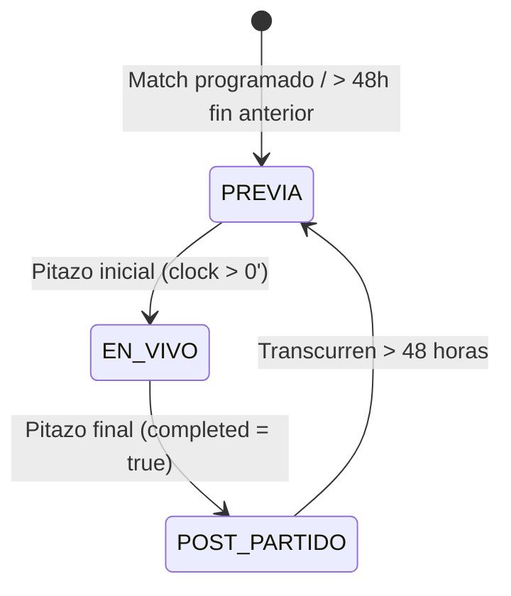

# Especificación Técnica y Arquitectura del Sistema (SPEC.md)
## Manya ServicioTI • Portal Integral y Match Center Oficial en Vivo

**URL Pública:** [manya.servicioti.com.uy](https://manya.servicioti.com.uy/)  
**Blogger CDN:** [www.servicioti.com.uy](https://www.servicioti.com.uy/)  
**Autor:** Andrés Franchi Ugartemendía (ServicioTI / eltopouy)  
**Versión:** 2.5 (Motor Dinámico 48 Horas & 1891 BD MCP)  
**Fecha de Actualización:** 30 de Octubre de 2026  

---

## 1. Misión del Proyecto y Filosofía Editorial

Manya ServicioTI es el centro de datos, inteligencia deportiva, cobertura en vivo y memoria histórica del Club Atlético Peñarol. Proporciona a los hinchas y medios una plataforma en tiempo real con datos certificados, análisis táctico de alto nivel y seguimiento minuto a minuto.

### 1.1. Tono y Línea Editorial (100% Futbolero)
- **Cero Romanticismo Abstracto:** Queda estrictamente desterrado cualquier estilo poético o metafórico excesivo.
- **Enfoque Futbolero y Táctico:** Lenguaje de tribuna, vestuario y pizarrón táctico uruguayo: presión alta, repliegue en bloque, transiciones rápidas, juego aéreo, marcas escalonadas, pelota quieta y tabla de posiciones.
- **Fusión de Medios Deportivos de Referencia:** Síntesis sinérgica de los principales enfoques periodísticos uruguayos (*Ovación, Tenfield, Telemundo 12, Telenoche 4, Referí, FútbolUy*), creando una impronta propia, atrevida y vibrante sin citar textualmente marcas externas.

---

## 2. Máquina de Estados y Ciclo de Vida de Partidos (Regla de las 48 Horas)

El orquestador (`automation/manya_match_engine.py` y `automation/manya_partidos_daemon.py`) opera bajo una máquina de estados determinista de 4 fases:



### Fase 1: PREVIA (Primer Plano Próximo Partido)
- **Activación:** Se activa cuando falta menos de 72 horas para el próximo encuentro o cuando el partido anterior ya superó las 48 horas post-pitazo.
- **Primer Plano:** 
  - Match Hero: Próximo partido (rival, fecha, hora, estadio, venta de entradas en TickAntel, canales de TV).
  - Radiografía del Rival: DT, esquema táctico base, figuras a seguir, puntos fuertes, vulnerabilidades y duelos 1x1.
  - Historial Frente a Frente: Certificación en tiempo real de **1891 BD** (`data/historial_activo.json`) con balance de PJ, PG, PE, PP, goles y efectividad.
  - Noticias y Claves en 60 Segundos: Actualidad de Los Aromos y tabla acumulada.
- **Segundo Plano (Histórico):** El partido anterior se almacena automáticamente en el cajón colapsable (`#historico-partido-anterior`), accesible con 1 clic para no saturar la vista principal.

### Fase 2: EN VIVO (Minuto a Minuto en Directo)
- **Activación:** Estado en juego (`state == "in"`). Polling cada 3 minutos desde ESPN API.
- **Primer Plano:** Reloj en vivo, marcador en directo, incidencias (goles, tarjetas amarillas/rojas, sustituciones), mapa táctico interactivo y tabla en vivo.
- **Sincronización:** Publicación y actualización automática en Blogger (`publicar_en_vivo_blogger.py`).

### Fase 3: POST-PARTIDO (Ventana de Cobertura de 48 Horas)
- **Activación:** Pitazo final (`completed == True` o `state == "post"`).
- **Duración:** Exactamente **48 horas** post-partido.
- **Primer Plano:** Cobertura de fondo del partido que recién culminó: crónica periodística definitiva, los 4 prismas de análisis, desglose de estadísticas (posesión, tiros, córners), declaraciones de vestuarios y repercusión en la Tabla Anual.
- **Anticipación:** Banner y ticker informan la fecha y sede del siguiente compromiso.

### Fase 4: TRANSICIÓN AUTOMÁTICA (+48 Horas)
- **Activación:** Automática al cumplirse `horas_desde_ultimo_partido > 48.0`.
- **Efecto:**
  - Archiva el partido finalizado en el cajón colapsable `#historico-partido-anterior`.
  - Transiciona la fase activa a `PREVIA`.
  - Resuelve dinámicamente el próximo rival (`manya_rival_intelligence.py`) y genera `data/historial_activo.json` sin intervención manual.

---

## 3. Integración con 1891 BD MCP (Comisión de Historia y Patrimonio)

El sistema se conecta de forma directa al servidor MCP remoto de la Comisión de Historia y Patrimonio de Peñarol (`https://mcp.1891.uy/mcp`):

1. **Herramienta `get_head_to_head`:**
   - Consulta balances oficiales contra cualquier rival de Primera División mediante su ID único en 1891:
     - Montevideo Wanderers: ID 321 (396 PJ, 207 PG, 113 PE, 76 PP, 701 GF, 394 GC, +131 victorias decanas).
     - Cerro Largo: ID 48 (30 PJ, 18 PG, 8 PE, 4 PP).
     - Danubio: ID 6 (253 PJ, 145 PG, 58 PE, 50 PP).
     - Miramar Misiones: ID 119 (40 PJ, 28 PG, 5 PE, 7 PP).
     - Juventud de Las Piedras: ID 260 (33 PJ, 23 PG, 7 PE, 3 PP).
     - Nacional: ID 405.
     - Defensor Sporting: ID 499.
     - Liverpool: ID 516.
   - Genera tanto `data/historial_[slug].json` como `data/historial_activo.json`.
2. **Herramienta `get_home_overview` y `on_this_day`:**
   - Efemérides diarias de partidos y natalicios históricos aurinegros guardados en `data/efemerides_hoy.json`.

---

## 4. Estructura de Datos y Módulos

```
C:\Users\Andrés\.gemini\antigravity\scratch\manya_servicioti\
├── assets/
│   ├── ig/                   # Fotografías y banners de portada (16:9 y 4:5)
│   ├── img/escudos/          # Catálogo WebP oficial de escudos AUF
│   └── gallery/              # Archivo fotográfico histórico certificado
├── data/
│   ├── live_status.json      # Estado central en vivo, tablas y fase de partido
│   ├── historial_activo.json # Historial 1891 BD del rival que se está jugando/preparando
│   ├── rival_intelligence.json # Scouting táctico, figuras y duelos 1x1
│   ├── news_digest.json      # Crónica y noticias de actualidad redactadas
│   ├── efemerides_hoy.json   # Efemérides 'Un día como hoy' de 1891 BD
│   ├── tatuajes_manya.json   # Galería de tatuajes carboneros (Instagram/TikTok)
│   └── squad_2026.json       # Plantel oficial y alineación táctica de Diego Aguirre
├── automation/
│   ├── manya_match_engine.py      # Motor de monitoreo, ESPN API, AUF y cálculo 48h
│   ├── manya_rival_intelligence.py# Scouting táctico y cliente 1891 BD MCP
│   ├── manya_partidos_daemon.py   # Orquestador y vigilante continuo de partidos
│   ├── blogger_manya_publisher.py # Publicador en Blogger API v3 (OAuth token.json)
│   └── extraer_datos_1891.py      # Extractor de fotos históricas y efemérides
├── js/
│   └── app.js                # Frontend interactivo, simulador de cancha y renderers
└── index.html                # Interfaz principal de manya.servicioti.com.uy
```

---

## 5. Protocolo de Despliegue y Resiliencia en Windows

1. **Rutas y Codificación:**
   - Uso obligatorio de `Path(__file__).resolve().parent` y `encoding="utf-8"`.
   - Compatibilidad con PowerShell (evitar checkmarks unicode en salidas de scripts de parcheo).
2. **Despliegue a Producción:**
   - Los cambios confirmados se envían a la rama `main` de GitHub.
   - GitHub Actions construye y despliega automáticamente el sitio en `https://manya.servicioti.com.uy/`.


---

## 6. Ciclo de Vida Editorial Tripartito y Automatización "Hoy Juega el Manya" (00:05 hs)

El portal y el sistema de publicación en Blogger operan bajo una máquina de estados estricta en base al calendario oficial y horario de Uruguay (`America/Montevideo` / UTC-3):

1. **La Previa / Víspera (Días anteriores hasta las 23:59 hs):**
   - Enfoque analítico y de vestuario: scouting táctico del rival, historial frente a frente (1891 BD), 4 duelos clave 1x1, venta de entradas y tabla acumulada.
   - En el Match Center se exhibe `PRÓXIMO PARTIDO`, la cuenta regresiva y la fecha precisa.

2. **Edición Especial Match Day: "¡HOY JUEGA EL MANYA!" (Disparo exacto a las 00:05 hs):**
   - **Disparador:** Tarea programada en Windows `Manya_Madrugada_0005_Hoy_Juega` (`programar_tarea_hoy_juega.ps1`) con parámetros de resiliencia (`-StartWhenAvailable`, `-WakeToRun`) a las `00:05` AM de cada día de partido.
   - **Contenido Generado:** Titular enérgico de match day (*"¡Hoy juega el Manya! Tarde de Parque Viera / CDS..."*), pronóstico meteorológico para la hora del partido (Open-Meteo), alineación probable matutina, televisación oficial y accesos.
   - **Frontend & Blogger:** Se actualiza el hero post estilo Instagram con el badge dorado `¡LLEGÓ EL DÍA!`, se activa `RIVAL DE HOY` en la tabla y se actualiza el post correspondiente en Blogger.

3. **En Vivo (Minuto a Minuto durante los 90 minutos):**
   - Polling cada 3 minutos en `fase == 'EN_VIVO'` con actualización de goles, incidencias y marcador.

4. **Post-Partido / Archivo Histórico (Ventana de 48 horas):**
   - La crónica final, estadísticas y balance se mantienen en primer plano durante 48 horas antes de pasar al cajón histórico replegable.
