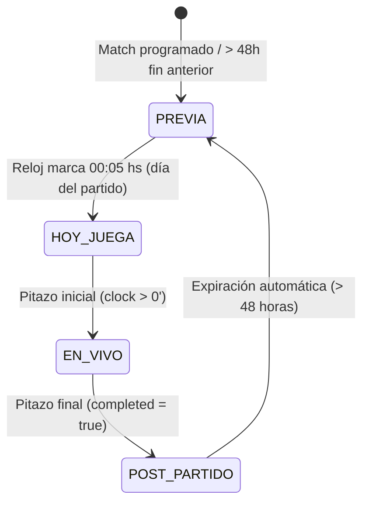

# Especificación Técnica y Arquitectura del Sistema (SPEC.md)
## Manya ServicioTI • Portal Integral y Match Center Oficial en Vivo

**URL Pública:** [manya.servicioti.com.uy](https://manya.servicioti.com.uy/)  
**Blogger CDN:** [www.servicioti.com.uy](https://www.servicioti.com.uy/)  
**Autor:** Andrés Franchi Ugartemendía (ServicioTI / eltopouy)  
**Versión:** 3.0 (Arquitectura Híbrida 24/7 de Alta Resiliencia & Auto-Curación Continua)  
**Fecha de Actualización:** 4 de Noviembre de 2026  

---

## 1. Misión del Proyecto y Filosofía Editorial

Manya ServicioTI es el centro de datos, inteligencia deportiva, cobertura en vivo y memoria histórica del Club Atlético Peñarol. Proporciona a los hinchas y medios una plataforma en tiempo real con datos certificados, análisis táctico de alto nivel y seguimiento minuto a minuto.

### 1.1. Tono y Línea Editorial (100% Futbolero)
- **Cero Romanticismo Abstracto:** Queda estrictamente desterrado cualquier estilo poético o metafórico excesivo.
- **Enfoque Futbolero y Táctico:** Lenguaje de tribuna, vestuario y pizarrón táctico uruguayo: presión alta, repliegue en bloque, transiciones rápidas, juego aéreo, marcas escalonadas, pelota quieta y tabla de posiciones.
- **Fusión de Medios Deportivos de Referencia:** Síntesis sinérgica de los principales enfoques periodísticos uruguayos (*Ovación, Tenfield, Telemundo 12, Telenoche 4, Referí, FútbolUy, Padre y Decano*), creando una impronta propia, atrevida y vibrante.

---

## 2. Máquina de Estados y Ciclo de Vida de Partidos (Regla de las 48 Horas)

El orquestador (`automation/manya_match_engine.py`, `automation/manya_partidos_daemon.py` y `automation/manya_self_healing_watchdog.py`) opera bajo una máquina de estados determinista de 4 fases:



### Fase 1: PREVIA (Primer Plano Próximo Partido)
- **Activación:** Se activa cuando el partido anterior ya superó las 48 horas post-pitazo o cuando faltan días para el próximo choque del fixture oficial AUF.
- **Primer Plano:** 
  - Match Hero: Próximo partido (rival, fecha, hora, estadio, venta de entradas vía RedTickets / Tickantel, canales de TV).
  - Radiografía del Rival: DT verificado, esquema táctico base, figuras a seguir, puntos fuertes, vulnerabilidades y duelos 1x1.
  - Historial Frente a Frente: Certificación en tiempo real de **1891 BD** (`data/historial_activo.json`) con balance de PJ, PG, PE, PP, goles y efectividad.
  - Noticias y Claves en 60 Segundos: Actualidad de Los Aromos y tabla acumulada con 66 puntos oficiales.
- **Segundo Plano (Histórico):** El partido anterior se almacena automáticamente en el cajón colapsable (`#historico-partido-anterior`), accesible con 1 clic para no saturar la vista principal.

### Fase 2: HOY JUEGA EL MANYA (Edición Especial de Match Day a las 00:05 hs)
- **Activación:** Apenas empieza el día del partido (00:05 hs en Uruguay, UTC-3).
- **Primer Plano:**
  - Badge dorado `¡LLEGÓ EL DÍA! • HOY JUEGA PEÑAROL`.
  - Pronóstico meteorológico para la hora del partido (Open-Meteo).
  - Canje y venta de entradas, tribunas habilitadas, operativos de transporte y ómnibus en vivo hacia el estadio.
  - Once titular probable proyectado por Diego Aguirre.

### Fase 3: EN VIVO (Minuto a Minuto en Directo)
- **Activación:** Estado en juego (`fase_partido == "EN_VIVO"`). Polling cada 3 minutos desde ESPN API.
- **Primer Plano:** Reloj en vivo, marcador en directo, incidencias (goles, tarjetas amarillas/rojas, sustituciones) y tabla en vivo.
- **Sincronización:** Publicación y actualización automática en Blogger (`publicar_en_vivo_blogger.py`).

### Fase 4: POST-PARTIDO (Ventana de Cobertura de 48 Horas)
- **Activación:** Pitazo final (`completed == True` o `state == "post"`).
- **Duración:** Exactamente **48 horas** post-partido.
- **Primer Plano:** Cobertura de fondo del partido que recién culminó: crónica periodística definitiva, los 4 prismas de análisis, marcador final, goleadores y repercusión en la Tabla Anual.
- **Anticipación:** Banner y ticker informan la fecha y sede del siguiente compromiso.

### Fase 5: TRANSICIÓN AUTOMÁTICA (+48 Horas)
- **Activación:** Automática al cumplirse `horas_desde_ultimo_partido > 48.0`.
- **Efecto:**
  - Archiva el partido finalizado en el cajón colapsable `#historico-partido-anterior`.
  - Transiciona la fase activa a `PREVIA`.
  - Resuelve dinámicamente el próximo rival (`manya_rival_intelligence.py`) y genera `data/historial_activo.json` sin intervención manual.

---

## 3. Estrategia de Automatización Continua 24/7 (Arquitectura Híbrida de 3 Niveles)

Para garantizar que el sitio esté **siempre actualizado todos los días** sin requerir supervisión humana, el sistema se apoya en 3 niveles sincronizados:

### Nivel 1: Programador de Tareas de Windows (Local 24/7)
Las tareas están configuradas con parámetros de resiliencia (`-StartWhenAvailable`, `-WakeToRun`) para ejecutarse puntualmente o inmediatamente al encender el equipo:
1. **`Manya_Guardian_Autocorreccion` (Cada 30 minutos):**
   - Ejecuta `automation/manya_self_healing_watchdog.py`.
   - Limpia locks trabados de más de 15 minutos.
   - Aplica la regla de 48 horas post-partido para transicionar a PREVIA.
   - Corrige puntos en todas las vistas (66 pts Anual).
   - Ejecuta la batería de pruebas (`test_manya_ecosystem.py`). Si pasa el 100%, empuja a GitHub Pages automáticamente.
2. **`Manya_Madrugada_0005_Hoy_Juega` (Diario a las 00:05 hs):**
   - Ejecuta `automation/manya_partidos_daemon.py --hoy-juega`.
   - Dispara a las 00:05 hs exactas del día de partido. Si hoy juega Peñarol, genera la edición especial de match day con clima y accesos.
3. **`Manya_Vigilante_Partidos_Y_Prensa` (Cada 30 minutos):**
   - Ejecuta `automation/manya_partidos_daemon.py --once`.
   - Escanea 5 periódicos uruguayos (Ovación, Referí, Tenfield, Padre y Decano, Google News), redacta la previa con IA (Gemini Web) y publica en Blogger API v3.

### Nivel 2: GitHub Actions Cloud Cron (Nube de Respaldo)
- Archivo de flujo: `.github/workflows/actualizar_partidos.yml`.
- **Frecuencia:** Cada 2 horas (`0 */2 * * *`).
- Si la computadora local está apagada o sin internet, los servidores de GitHub en la nube ejecutan:
  `manya_match_engine.py`, `extraer_datos_1891.py`, `manya_rival_intelligence.py`, `manya_self_healing_watchdog.py` y `test_manya_ecosystem.py`.
- Si detecta cambios en las tablas o la expiración de las 48 horas, hace commit automático y despliega el portal.

### Nivel 3: Sistema de Auto-Curación y Guardián Autónomo
- Implementado en `automation/manya_self_healing_watchdog.py`.
- Si un scraper falla o la API devuelve un dato inconsistente, el watchdog detecta el error en `test_manya_ecosystem.py`, aplica la corrección determinista (puntos oficiales, rival activo del fixture AUF, escenario oficial) y re-testea hasta alcanzar el **100% de salud**.

---

## 4. Integración con 1891 BD MCP (Comisión de Historia y Patrimonio)

El sistema se conecta de forma directa al servidor MCP remoto de la Comisión de Historia y Patrimonio de Peñarol (`https://mcp.1891.uy/mcp`):

1. **Herramienta `get_head_to_head`:**
   - Consulta balances oficiales contra cualquier rival de Primera División mediante su ID único en 1891:
     - Montevideo Wanderers: ID 321 (396 PJ, 207 PG, 113 PE, 76 PP).
     - Defensor Sporting: ID 499 (337 PJ, 199 PG, 80 PE, 58 PP, +141 victorias decanas).
     - Danubio: ID 6 (253 PJ, 145 PG, 58 PE, 50 PP).
     - Nacional: ID 405.
     - Liverpool: ID 516.
     - Cerro Largo: ID 48.
     - Miramar Misiones: ID 119.
   - Genera tanto `data/historial_[slug].json` como `data/historial_activo.json`.
2. **Herramienta `get_home_overview` y `on_this_day`:**
   - Efemérides diarias de partidos y natalicios históricos aurinegros guardados en `data/efemerides_hoy.json`.

---

## 5. Estructura de Datos y Módulos

```
C:\Users\Andrés\.gemini\antigravity\scratch\manya_servicioti\
├── assets/
│   ├── ig/                   # Fotografías y banners de portada (16:9 y 4:5)
│   ├── img/escudos/          # Catálogo WebP oficial de escudos AUF
│   └── gallery/              # Archivo fotográfico histórico certificado
├── data/
│   ├── live_status.json      # Estado central en vivo, tablas y fase de partido
│   ├── historial_activo.json # Historial 1891 BD del rival que se está jugando/preparando
│   ├── rival_intelligence.json # Scouting táctico, figuras y duelos 1x1
│   ├── news_digest.json      # Crónica y noticias de actualidad redactadas
│   ├── efemerides_hoy.json   # Efemérides 'Un día como hoy' de 1891 BD
│   ├── tatuajes_manya.json   # Galería de tatuajes carboneros (Instagram/TikTok)
│   ├── health_status.json    # Auditoría de salud y score de pruebas del ecosistema
│   └── squad_2026.json       # Plantel oficial y alineación táctica de Diego Aguirre
├── automation/
│   ├── manya_match_engine.py      # Motor de monitoreo, fixture AUF y cálculo 48h
│   ├── manya_rival_intelligence.py# Scouting táctico y cliente 1891 BD MCP
│   ├── manya_partidos_daemon.py   # Orquestador y vigilante continuo de partidos y prensa
│   ├── manya_self_healing_watchdog.py # Guardián de auto-reparación y auto-mejora
│   ├── test_manya_ecosystem.py    # Suite integral de pruebas automatizadas (100% OK)
│   ├── sincronizar_pagina_proximo_partido.py # Sincronizador de previa en Blogger
│   ├── sincronizar_pagina_blogger_historico.py # Archivo histórico en Blogger
│   └── registrar_tareas_programadas_resilientes.ps1 # Instalador de tareas en Windows
├── js/
│   └── app.js                # Frontend interactivo, simulador de cancha y renderers
├── sw.js                     # Service Worker PWA con Network-First y cache buster
└── index.html                # Interfaz principal de manya.servicioti.com.uy
```

---

## 6. Suite de Pruebas y Certificación de Calidad

Para cada despliegue, la suite [`test_manya_ecosystem.py`](file:///C:/Users/Andr%C3%A9s/.gemini/antigravity/scratch/manya_servicioti/automation/test_manya_ecosystem.py) evalúa 8 dimensiones críticas con resultado **100% ÓPTIMO**:
1. Zona Horaria UY_TZ (`America/Montevideo` / UTC-3).
2. Coherencia Temporal (`es_hoy`).
3. Integridad de Puntos (Tabla Anual 66 pts).
4. Verificación de Rival, DT y Escenario Activo.
5. Integridad de Esquemas JSON (11 datasets validados).
6. Salud de Locks y Anti-Colisión (`~/.manya_locks/`).
7. Accesibilidad HTTP 200 de los 5 Endpoints Oficiales (Portal y Blogger).
8. PWA Network-First, selector de tablas Clausura/Anual y versión de caché.
